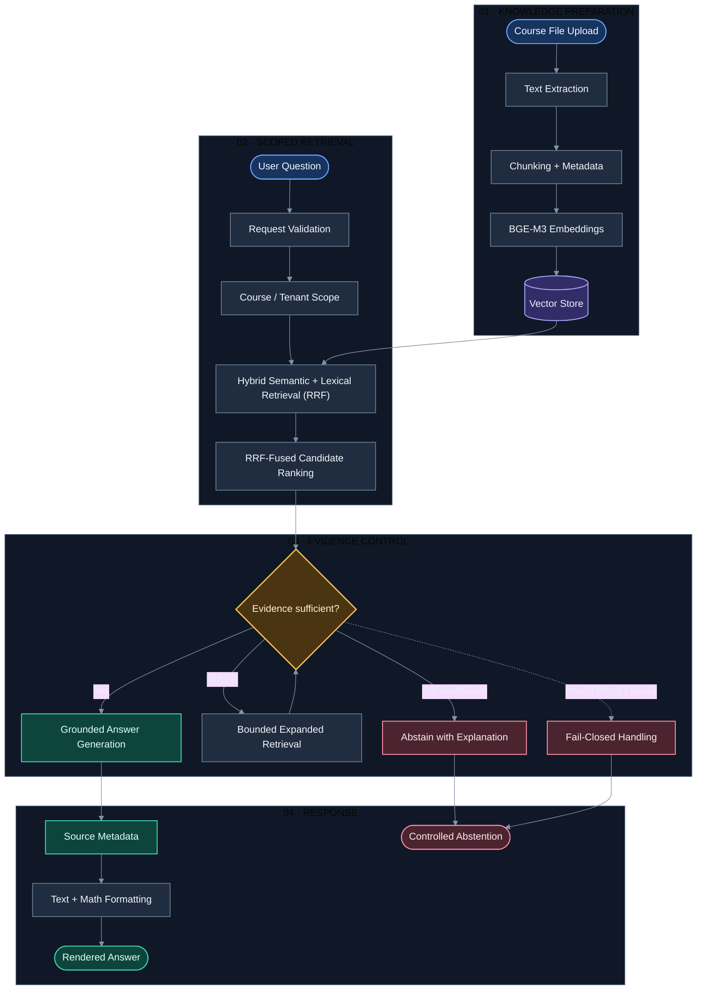
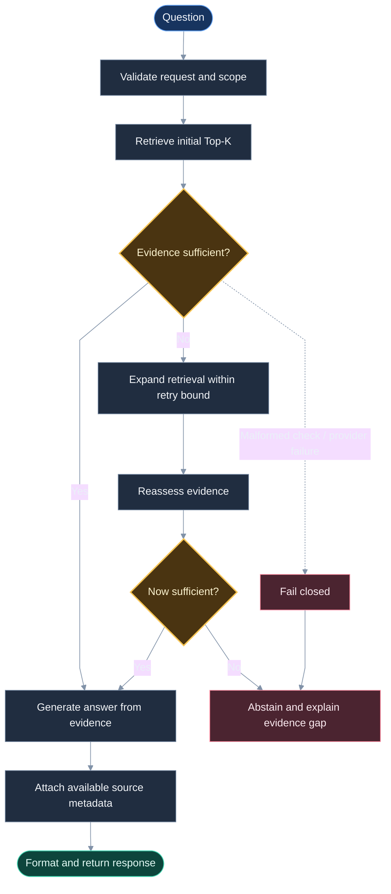
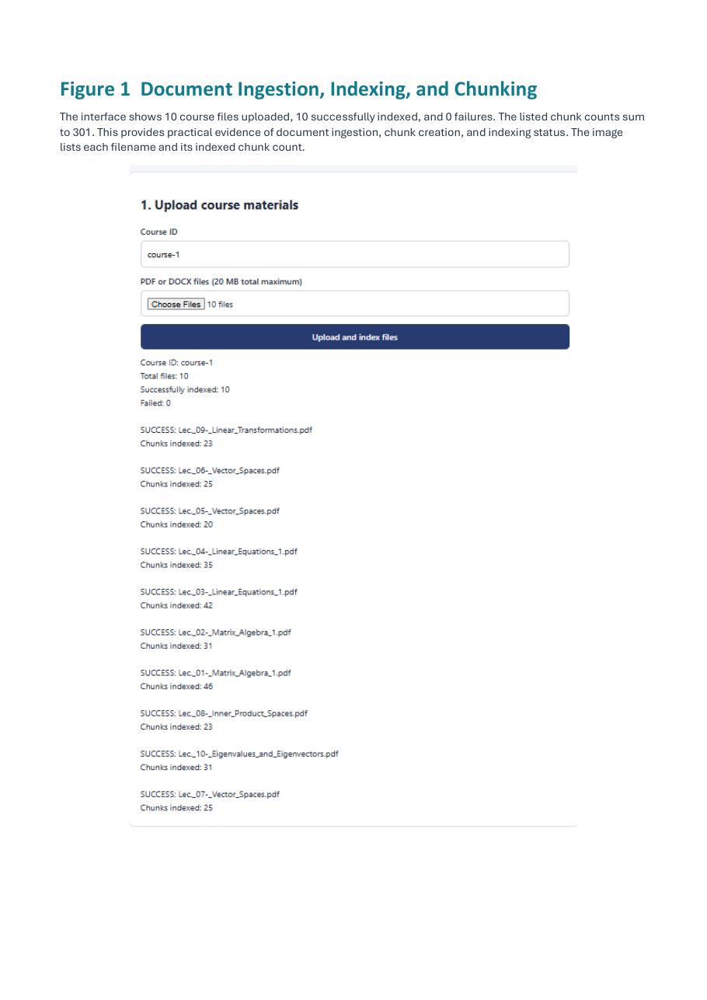
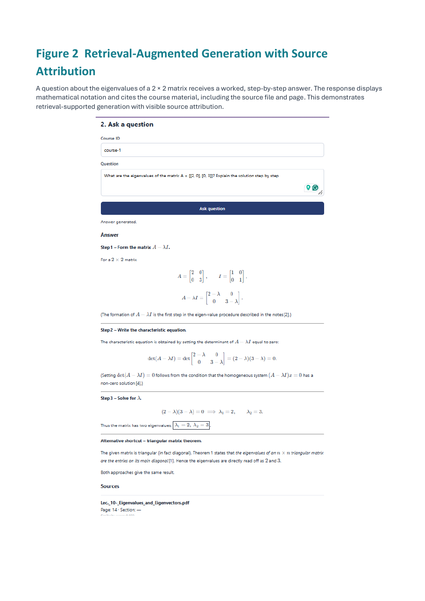
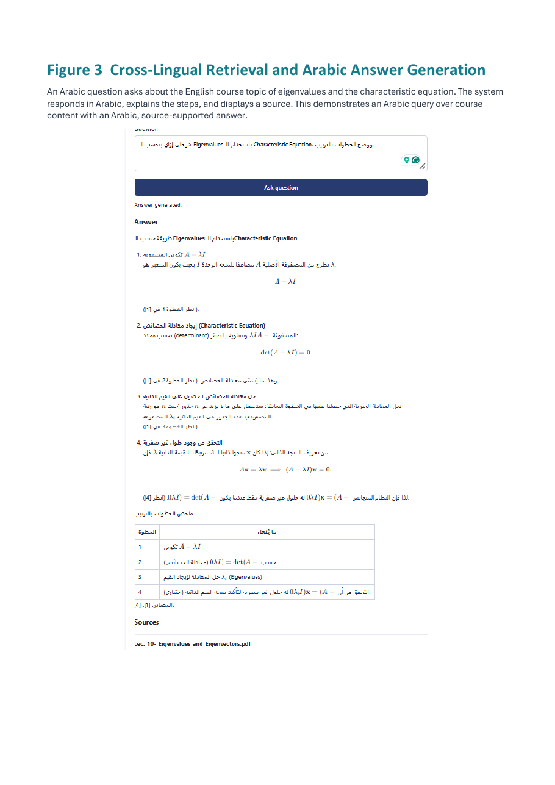
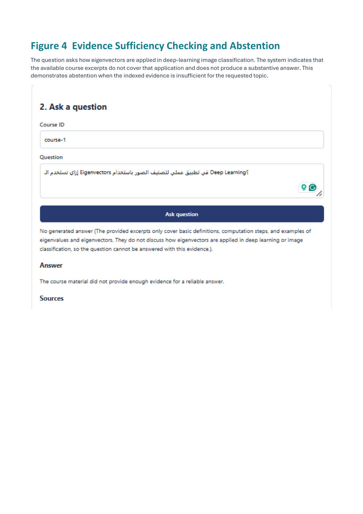
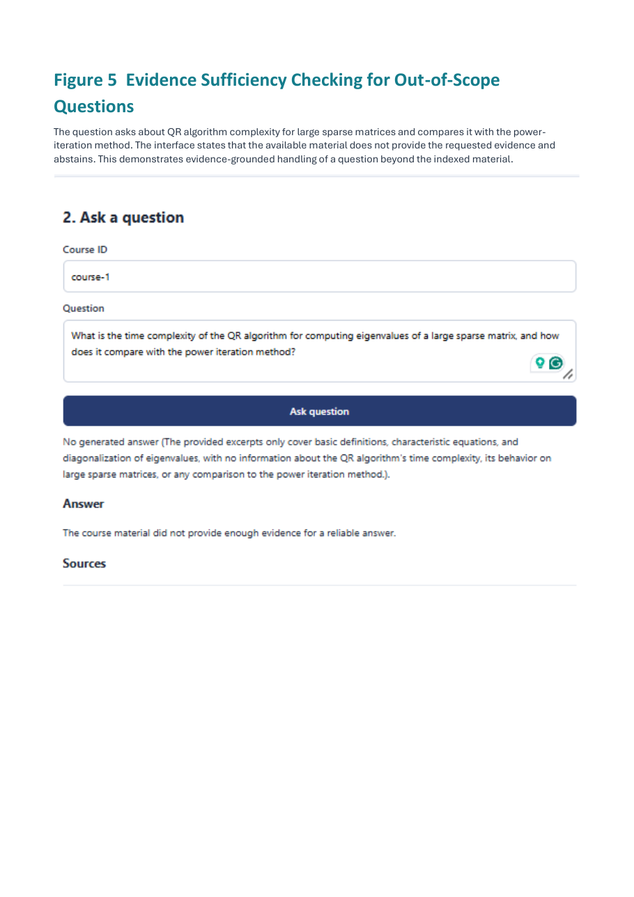

# Research-Driven Multilingual RAG System

**Evidence-Grounded Retrieval-Augmented Generation for Arabic–English Learning Content**

A research-driven RAG application designed to retrieve relevant learning evidence across Arabic and English, assess whether that evidence is sufficient, and produce source-attributed answers with readable mathematical notation. The system combines multilingual embeddings, hybrid semantic–lexical search with Reciprocal Rank Fusion (RRF), bounded retrieval recovery, controlled abstention, and a UI built for mixed Arabic-English technical content.

**Technology:** Python 3.13 · FastAPI · BGE-M3 · Groq-compatible LLM API

**Core capabilities:** Hybrid retrieval + RRF · Cross-lingual search · Mixed-language query handling · Evidence sufficiency · Source attribution · Mathematical rendering

---

## Contents

- [Architecture](#architecture)
- [Overview](#overview)
- [Ingestion and Indexing](#ingestion-and-indexing)
- [Multilingual and Cross-Lingual Retrieval](#multilingual-and-cross-lingual-retrieval)
- [Evidence Sufficiency and Abstention](#evidence-sufficiency-and-abstention)
- [Reliability Hardening](#reliability-hardening)
- [Grounded Answers and Source Attribution](#grounded-answers-and-source-attribution)
- [Mathematical and Mixed-Language Rendering](#mathematical-and-mixed-language-ui-rendering)
- [Research Foundation](#research-foundation)
- [Technology, API, and Configuration](#technology-api-and-configuration)
- [Evaluation Priorities and Known Boundaries](#evaluation-priorities-and-known-boundaries)
- [Run the Project](#run-the-project)
- [Final Application Validation](#final-application-validation)

---


## Architecture



### Runtime decision path



The exact retry count and implementation details should follow the active backend configuration. The design principle is bounded recovery, reassessment, and abstention if sufficient evidence still cannot be established.

---


## Overview

This project is a research-driven, multilingual Retrieval-Augmented Generation (RAG) application for answering questions from uploaded learning materials. It combines document ingestion and indexing with **hybrid semantic–lexical retrieval**, **Reciprocal Rank Fusion (RRF)**, cross-lingual search, evidence-sufficiency checks, bounded retrieval recovery, controlled abstention, source attribution, and a UI that supports Arabic-English content and rendered mathematical notation.

The system is designed around a reliability principle: finding text that looks related is not enough. Retrieved passages must provide evidence for the question; when they do not, the system should explain the gap instead of inventing an answer. The implementation also handles mixed-language queries, including technical English terms written with Arabic characters, as part of its practical multilingual search workflow.

The sections below describe the system architecture and engineering choices first. Application screenshots and the measured validation snapshot are kept together at the end so the opening stays focused on the design rather than raw evidence images.

### Design objectives

| Objective | Engineering response |
|---|---|
| Retrieve relevant course content | Multilingual semantic embeddings with BGE-M3 |
| Preserve course boundaries | Tenant/course-scoped retrieval and isolation tests |
| Reduce unsupported answers | Evidence-sufficiency assessment and abstention |
| Recover missed evidence | Bounded expanded retrieval and reassessment |
| Keep answers inspectable | Source metadata such as filename/page/section/text where available |
| Support technical learning | Mathematical formatting and mixed Arabic-English presentation |
| Make failure behavior testable | API, isolation, sufficiency, refusal, and formatter tests |
| Use research responsibly | Separate implemented behavior, observed results, and proposed experiments |

## Ingestion and Indexing

The ingestion pipeline converts supported course files into searchable chunks.

- **Extraction:** obtain text from uploaded documents and handle unsupported, empty, or damaged inputs explicitly.
- **Chunking:** split long material into focused passages while preserving enough context for retrieval.
- **Metadata:** retain identifiers and source information needed for traceability.
- **Embedding:** encode chunks using BGE-M3 for multilingual semantic retrieval.
- **Indexing:** store vectors and metadata under the relevant course scope.

Chunking is an important quality dependency: the relevant concept may exist in the original document but be hard to retrieve if it is split across poorly chosen boundaries or loses its explanatory context.

The documented automated tests focus on DOCX extraction and edge cases. The application evidence shows a successful ten-PDF indexing run. Broader PDF behavior should continue to be validated with dedicated fixtures for pages, tables, mathematical notation, damaged files, and scanned documents.

---

## Multilingual and Cross-Lingual Retrieval

The system uses **BAAI BGE-M3**, a multilingual embedding model, to represent queries and document chunks as vectors:

\[
f(x) \rightarrow \mathbf{v}_x
\]

The retrieval pipeline combines semantic and lexical signals, then uses Reciprocal Rank Fusion (RRF) to combine ranked candidates. This helps retain passages that are semantically related even when exact wording differs, while lexical matching can preserve useful term-level matches.

### Implemented multilingual behavior

Cross-lingual retrieval is implemented and has been exercised in the application. A documented example uses an Arabic question about the characteristic equation and eigenvalues against English course material; the system responds in Arabic, explains the steps, renders mathematical notation, and displays a source. Mixed Arabic-English questions are supported, including technical English terms typed in Arabic script.

These are implemented behaviors, not a claim that every language direction has identical retrieval quality. Quality parity still needs a larger labelled benchmark.

### Cross-lingual failure modes

A multilingual embedding model does not guarantee:
- Equal ranking quality for Arabic-to-English and English-to-Arabic retrieval.
- Robust handling of every possible spelling or transliteration variant; mixed-script and Arabic-script technical terms are supported, but broader coverage still benefits from systematic evaluation.
- Retrieval of the correct passage inside Top-K.
- Sufficient evidence just because a similarity score is high.
- Correct final answers when evidence is missing.

| Query language | Document language | Evaluation target |
|---|---|---|
| Arabic | Arabic | Relevant chunk rank and recall |
| English | English | Relevant chunk rank and recall |
| Arabic | English | Cross-language evidence retrieval |
| English | Arabic | Reverse-direction cross-language retrieval |
| Mixed Arabic-English | Either | Retrieval of the intended technical concept |
| Arabizi | Arabic / English | Transliteration robustness |

### Retrieval fusion and evaluation

Hybrid semantic–lexical retrieval and RRF are implemented. The next evaluation step is not to build these features from scratch, but to quantify their contribution against controlled semantic-only and lexical-only baselines using the same queries, corpus, and candidate budget. Query translation or language-balanced ranking can be explored as additional experiments if the benchmark shows a need; they are not prerequisites for the currently working hybrid pipeline.

---

## Evidence Sufficiency and Abstention

**Evidence sufficiency is a core reliability boundary.** It asks whether retrieved passages contain enough information to answer the specific question—not simply whether they are related to the topic.

A vector retriever ranks candidates. It does not prove that the correct answer is present.

### Why a separate sufficiency gate matters

Suppose a course covers eigenvalues and diagonalization. A question about using eigenvectors in deep-learning image classification may share vocabulary with that material, but the retrieved excerpts may not explain the requested application. Without an evidence gate, the language model may fill the gap with plausible background knowledge.

The sufficiency stage helps distinguish:
- Relevant and sufficient evidence.
- Related but incomplete evidence.
- Empty retrieval.
- Context that does not answer the actual question.
- Invalid or unavailable sufficiency-check output.

### Real observed abstention examples

**Example A — Eigenvectors in deep-learning image classification.** The UI explains that the indexed excerpts cover basic definitions and computations but do not explain that deep-learning application. No substantive answer is generated.

**Example B — QR algorithm complexity versus power iteration.** The UI states that the available course material does not provide the requested complexity information or comparison and abstains.

These examples show why related content is not necessarily sufficient evidence.

### Retry and fail-closed behavior

When initial evidence is insufficient, a bounded expanded retrieval attempt may recover a passage that fell outside the initial candidate set. The system must reassess the evidence after retrieval; more chunks do not automatically mean better evidence.

A robust control path should:
1. Preserve the original question and course scope.
2. Expand retrieval within a configured bound.
3. Reassess the new context.
4. Stop when the retry limit is reached.
5. Abstain if evidence is still insufficient.

Invalid checker output must not be interpreted as permission to generate. The documented test inventory includes invalid JSON, non-boolean output, and provider-failure cases. These exercise **fail-closed behavior**: failure to establish sufficiency is not the same as establishing sufficiency.

### Abstention must be calibrated

- **Missed abstention:** the system answers despite insufficient evidence.
- **False abstention:** the system refuses when sufficient evidence was available.

A useful system must measure both. Abstaining on every question is safe in a narrow sense but not useful as a tutor.

---

## Reliability Hardening

Hardening is a set of controls across input validation, scope enforcement, checker-output validation, bounded retry, generation failures, and presentation.

| Failure surface | Defensive behavior | Verification |
|---|---|---|
| Unsupported or malformed upload | Controlled API error | API validation tests |
| Empty/damaged document | Detect extraction failure | Extraction tests |
| Wrong course context | Keep retrieval scoped | Isolation tests |
| Empty evidence | Avoid unsupported generation | Pipeline/refusal tests |
| Insufficient context | Bounded retry, then abstain | Sufficiency tests |
| Invalid checker response | Validate and fail closed | Invalid JSON/type/provider-error tests |
| Generation exception | Controlled failure outcome | Refusal tests |
| Empty generated answer | Do not treat as success | Refusal tests |
| Chunk-key collision across courses | Preserve scope-aware store keys | Store-key tests |
| Raw mathematical markup | Format supported notation | Formatter tests and manual UI verification |
| Restart with in-memory storage | Do not assume persistence | Restart test still needed |

### Course isolation

Retrieval must remain scoped to the relevant course/tenant. A chunk from another course must not be used merely because it is semantically similar. The documented test inventory includes isolation cases and store-key behavior for matching chunk IDs in separate course contexts.

### Input and output validation

Documented API coverage includes health behavior, missing course identifiers, unsupported extensions, malformed requests, upload/indexing paths, and question-answer responses. Sufficiency/refusal coverage includes invalid checker output, provider failures, and empty generation outputs.

### Storage limitation

The documented setup uses an in-memory store. Unless persistent storage is configured, indexed content should not be assumed to survive backend restarts.

---

## Grounded Answers and Source Attribution

Once the evidence gate accepts the retrieved context, the generation stage formulates an answer using course material. The response includes available source metadata such as filename, page, section, text, and retrieval score where supported by the implementation.

### Observed source-backed answer

The supplied report shows a step-by-step solution to an eigenvalues question, including mathematical notation and a source filename/page. The Arabic cross-lingual example also displays a source.

Citation presence is not the same as citation correctness. A stronger evaluation should verify:
- The referenced file and page exist.
- The passage supports the associated claim.
- The answer does not introduce unsupported claims.
- Each citation points to the relevant evidence, not merely a related passage.

A claim-to-evidence groundedness benchmark remains a high-value next step.

---

## Mathematical and Mixed-Language UI Rendering

Technical answers may contain inline LaTeX, display equations, matrices, fractions, subscripts, superscripts, Arabic prose, and English technical terms.

If the frontend treats mathematical notation as plain text, users may see raw delimiters instead of rendered equations. The formatting work addresses this presentation issue so supported expressions display as mathematics.

Documented formatter tests include:
- Plain-text answers.
- Inline and display LaTeX.
- Dollar delimiters.
- Multiple equations.
- Arabic mixed with mathematical notation.
- Empty or invalid answer content.

The reported UI verification showed mathematical content rendered in the answer interface. Formatter unit tests validate formatting logic, while browser-level regression tests remain useful for confirming end-to-end behavior in the rendered UI.

Presentation quality is separate from factual correctness: a well-rendered equation can still be unsupported, and a correct equation can still be difficult to use if rendered incorrectly.

---

## Research Foundation

Research is used to identify failure modes and guide engineering decisions. Paper findings must not be presented as project results, and research-described techniques must not be claimed as implemented without code evidence.

### Paper 1 — *The Cross-Lingual Cost: Retrieval Biases in RAG over Arabic-English Corpora*

**Authors:** Chen Amiraz, Yaroslav Fyodorov, Elad Haramaty, Zohar Karnin, and Liane Lewin-Eytan. **Year:** 2025, as recorded in the supplied research notes.

**Problem:** A relevant passage may exist but rank below Top-K when Arabic and English documents compete in a shared ranking. Cross-language retrieval can behave differently from same-language retrieval even with multilingual embeddings.

**Methods discussed in the supplied notes:**
- BGE-M3 and Multilingual-E5-Large comparisons.
- Arabic-Arabic, Arabic-English, English-Arabic, and English-English retrieval.
- Analysis of query-document and document-document language mismatch.
- Language-restricted analysis.
- Query translation and balanced retrieval as possible mitigations.

**Implications for this project:**
1. Evaluate retrieval separately from generation.
2. Track language directions independently.
3. Measure whether the expected evidence enters Top-K.
4. Treat language-related ranking bias as a potential failure mode.
5. Compare mitigation strategies on the actual course corpus.

**Project connection:** BGE-M3 powers the multilingual semantic component; hybrid semantic–lexical retrieval with RRF is implemented, and the application evidence demonstrates an Arabic question answered from English course material. The examples establish working behavior in tested scenarios, while a larger labelled benchmark is still needed to quantify quality across language directions.

### Paper 2 — *ARAG: An Agent-Based Hybrid Semantic-Lexical Retrieval-Augmented Generation Pipeline for Arabic Texts*

**Authors:** Mushari Alothman, Abdullah Altammami, Muneera Alhoshan, Amal Almazrua, Raghad Al-Rasheed, Rawan N. Al-Matham, Afrah Altamimi, Omar Elnashar, Mohamed Amin, Bayan Almuqhim, Abdulrahman Alosaimy, and Abdullah Alfaifi. **Year:** 2026, as recorded in the supplied notes.  
**DOI:** [10.1016/j.procs.2026.01.079](https://doi.org/10.1016/j.procs.2026.01.079)

**Problem:** Arabic RAG retrieval and evaluation, including the complementary roles of semantic and lexical signals. The supplied notes emphasize that lexical overlap alone can misjudge answer quality when equivalent answers use different wording.

**Implications for this project:**
- Use fixed question/reference sets for repeatable evaluation.
- Separate retrieval quality from answer correctness.
- Distinguish exact wording overlap from semantic correctness.
- Compare retrieval strategies under the same conditions.
- Preserve difficult cases for regression testing.

**Project connection:** The project has hybrid retrieval with RRF, retrieval metric utilities, refusal-path tests, mixed-language and mathematical cases, and a test inventory. Evaluation should measure the contribution of each retrieval component and assess answer meaning separately from exact lexical overlap.

### Research-to-engineering map

| Research insight | Engineering implication | Evidence / next experiment |
|---|---|---|
| Cross-language ranking may be uneven | Evaluate language directions separately | One observed cross-lingual example; broader labelled benchmark needed |
| Semantic and lexical signals are complementary | Compare semantic-only, lexical-only, and hybrid retrieval | Controlled same-dataset comparison still needed |
| Lexical overlap does not equal semantic correctness | Evaluate meaning separately from exact wording | Add semantic answer-quality evaluation |
| Similarity does not establish answerability | Use sufficiency gate and abstention | Two observed abstention examples plus automated control-path tests |
| Invalid control output cannot be trusted | Validate checker response and fail closed | Automated invalid-output/provider-failure tests |
| Source presence does not prove groundedness | Verify citations against claims | Add claim-to-source evaluation |

**Implementation integrity:** Hybrid semantic–lexical retrieval, RRF, cross-lingual search, mixed-language query handling, evidence sufficiency, controlled abstention, and mathematical UI rendering are described as implemented based on the project owner's confirmation and the supplied application evidence. Claims about a specific self-consistency strategy or language-balanced reranking should be limited to what the current code and its tests demonstrate.

---

## Technology, API, and Configuration

### Technology stack

| Component | Technology | Role |
|---|---|---|
| Language | Python | Backend and RAG logic |
| API | FastAPI | HTTP routes and request validation |
| Embeddings | BAAI BGE-M3 | Multilingual semantic vectors |
| LLM interface | OpenAI-compatible API configuration | Sufficiency checks and answer generation |
| Provider in documented setup | Groq-compatible endpoint | Hosted inference |
| Tests | pytest | Unit and integration-style test coverage |
| Store | In-memory in documented setup | Runtime vector/chunk storage |
| Frontend | Existing application UI | Upload/index, answer display, sources, math rendering |

Use `pyproject.toml` and the lockfile as the source of truth for exact dependency versions.

### API overview

The backend exposes health behavior and workflows for document ingestion and question answering. Keep exact paths and schemas synchronized with the active FastAPI routes.

- `GET /api/health` — health check.
- `GET /` — root endpoint; previously reported to return HTTP 200.
- **Upload/indexing workflow** — accepts supported course files, extracts and chunks text, and indexes content under the relevant course scope.
- **Question-answer workflow** — validates request, retrieves scoped evidence, checks sufficiency, retries within the configured bound when appropriate, generates only when evidence is sufficient, and returns source metadata or controlled abstention.

Illustrative response shape (not a guaranteed verbatim schema):

```json
{
  "answer": "Answer grounded in retrieved course material",
  "abstained": false,
  "reason": null,
  "message": null,
  "sources": [
    {
      "filename": "Lec_10_-_Eigenvalues_and_Eigenvectors.pdf",
      "page": 14,
      "section": null,
      "text": "Supporting source passage",
      "score": 0.82
    }
  ]
}
```

### Environment configuration

```dotenv
LLM_BASE_URL=https://api.groq.com/openai/v1
LLM_API_KEY=replace_with_your_own_key
LLM_MODEL=openai/gpt-oss-120b

RAG_EMBED_MODEL=BAAI/bge-m3
RAG_TOP_K=5
```

These values reflect the documented setup and should be checked against the active environment.

**Security:** never commit real API keys or `.env` files. Keep credentials out of logs, record model and retrieval settings with benchmark outputs, and keep live provider tests separate from deterministic unit tests.

---

## Evaluation Priorities and Known Boundaries

The core retrieval and presentation features described above are implemented. The remaining priorities are primarily about **measurement, regression coverage, and deployment behavior**, rather than treating working features as unimplemented.

1. **Quantify hybrid retrieval gains:** compare semantic-only, lexical-only, and hybrid + RRF on the same labelled query set and candidate budget.
2. **Broaden cross-lingual evaluation:** report results separately for Arabic→English, English→Arabic, same-language, mixed-script, and Arabic-script technical-term queries.
3. **Evaluate Arabizi and spelling variation:** extend the test set across transliteration styles and measure whether the correct evidence appears in Top-K.
4. **Citation correctness:** verify that cited passages support the claims they accompany, rather than measuring citation presence alone.
5. **Abstention calibration:** report missed abstentions, false abstentions, precision, recall, and a confusion matrix on a labelled set.
6. **Document extraction coverage:** add fixtures for PDF tables, equations, damaged documents, and scanned pages as applicable to the supported ingestion pipeline.
7. **UI regression:** preserve the already-fixed math rendering and mixed Arabic-English display with automated browser checks.
8. **Persistence and deployment:** confirm whether the configured store is in-memory or persistent in the target deployment, and test restart behavior accordingly.
9. **Self-consistency evaluation:** document the configured strategy and measure any reliability gain against added latency and cost.

These are validation and improvement priorities; they should not be read as a claim that hybrid search, RRF, cross-lingual search, mixed-language input, or math rendering are absent.

---

## Run the Project

The commands below reflect the documented setup. Confirm the actual module path and frontend commands in the current repository.

### Prerequisites

- Python 3.13 or the project-specified version.
- `uv`.
- Provider configuration for live inference.
- Frontend dependencies if running the UI.

### Install dependencies

```bash
uv sync
```

### Run tests

```bash
uv run pytest -q
```

### Start FastAPI

Replace `<module>` with the actual module containing the FastAPI `app` object:

```bash
uv run uvicorn <module>:app --host 127.0.0.1 --port 5000
```

The API was previously reported at `http://127.0.0.1:5000`, with health and root endpoints returning HTTP 200 in that verification run.

### Operational reminders

- Re-index documents after restarting if the active store is in-memory.
- Keep evaluation datasets versioned.
- Record embedding model, LLM model, Top-K, and provider settings with each benchmark.
- Separate automated tests, manual UI observations, and benchmark results in reports.

---

## Conclusion

This project treats RAG as a reliability problem—not merely a prompt connected to vector search.

Its architecture separates document preparation, scoped multilingual retrieval, evidence sufficiency, bounded recovery, grounded generation, source attribution, and answer presentation. The hardening approach makes failure behavior explicit: invalid evidence checks, insufficient context, generation failures, and scope violations should not silently become successful answers.

The research foundation frames the next engineering questions: how cross-lingual ranking behaves across language directions, when lexical and semantic retrieval complement each other, how to measure semantic correctness, and how to evaluate abstention and citation correctness systematically.

> **A trustworthy RAG system should not only retrieve and generate. It should establish whether evidence is sufficient, preserve the relationship between the answer and its sources, present the result clearly, and fail safely when the evidence is not there.**

### Research references

1. Amiraz, C., Fyodorov, Y., Haramaty, E., Karnin, Z., & Lewin-Eytan, L. (2025, as recorded in supplied notes). *The Cross-Lingual Cost: Retrieval Biases in RAG over Arabic-English Corpora*. 
2. Alothman, M., Altammami, A., Alhoshan, M., Almazrua, A., Al-Rasheed, R., Al-Matham, R. N., et al. (2026, as recorded in supplied notes). *ARAG: An Agent-Based Hybrid Semantic-Lexical Retrieval-Augmented Generation Pipeline for Arabic Texts*. https://doi.org/10.1016/j.procs.2026.01.079

---

## Final Application Validation: Linear Algebra Course Corpus

This section intentionally appears at the end: the architecture, engineering techniques, and research rationale come first; the following is the practical validation snapshot from the supplied application evidence.

### Test setup and indexing result

A practical run used a **Linear Algebra course corpus** consisting of **10 PDF files**.

| Measure | Observed result |
|---|---:|
| Files uploaded | 10 |
| Files indexed successfully | 10 |
| Indexing failures | 0 |
| Total indexed chunks | 301 |

The application showed these indexed materials covering linear transformations, vector spaces, linear equations, matrix algebra, inner-product spaces, eigenvalues, and eigenvectors. The file-by-file chunk inventory is intentionally omitted here so the README focuses on the architecture and techniques rather than on lecture filenames.

### Representative end-to-end checks

| Scenario | Observed application behavior | What it demonstrates |
|---|---|---|
| English question about eigenvalues of a 2 × 2 matrix | Step-by-step answer with mathematical notation and source filename/page | Retrieval-supported generation and source attribution |
| Arabic question about eigenvalues / characteristic equation in English course material | Arabic explanation with mathematical notation and a displayed source | A successful cross-lingual example in the tested case |
| Question about applying eigenvectors in deep-learning image classification | No substantive answer; UI explained that the indexed excerpts did not cover the application | Evidence-sufficiency handling and abstention for an out-of-scope question |
| Question about QR algorithm complexity for large sparse matrices versus power iteration | Abstained because the indexed material did not contain the requested evidence | Evidence-grounded handling of a second out-of-scope question |

These observations come from the supplied application evidence report. They demonstrate behavior in the displayed examples; they do not establish universal accuracy across all questions or language combinations.

### Automated test-suite snapshot

A previously reported full test run recorded **60 passed, 1 warning**. The warning concerned a deprecated embedding-dimension method in the BGE-M3 wrapper and did not fail that run.

This automated test result is separate from the ten-file manual/application validation above. Unit tests, application screenshots, retrieval metrics, and live-provider behavior should not be conflated.

A separate earlier retrieval benchmark reported Hit@3 = 1.0 and Recall@3 = 1.0 on six scored questions. Because that benchmark was small, it is recorded as an initial smoke-test result rather than presented as the project's main achievement or as evidence of universal accuracy.

### Interpretation

The practical validation supports four bounded claims:

1. The tested ten-file Linear Algebra corpus was indexed successfully, producing 301 chunks with no reported upload/indexing failures.
2. The application produced a source-attributed step-by-step answer for the tested eigenvalues question.
3. The application answered one Arabic question using English course material and returned an Arabic response with a source.
4. The application abstained on two questions whose required evidence was not present in the indexed excerpts.

The results validate these specific scenarios. Hybrid retrieval, RRF, cross-lingual search, mixed-language query handling, and math rendering are implemented; the next step is to quantify their performance with larger, labelled experiments. These screenshots alone do not establish cross-lingual parity, the size of hybrid-retrieval gains, citation correctness across all answers, or the effectiveness of any self-consistency strategy.


### Application Evidence Screenshots

The following figures are taken from the supplied *Practical Implementation Evidence* PDF. They are placed here at the end of the README as validation evidence, rather than interrupting the introduction or architecture explanation.

#### Figure 1 — Document ingestion, indexing, and chunking



#### Figure 2 — Retrieval-augmented answer with source attribution



#### Figure 3 — Cross-lingual retrieval and Arabic answer generation



#### Figure 4 — Evidence sufficiency and abstention for an out-of-scope question



#### Figure 5 — Abstention when requested algorithm-complexity evidence is absent


